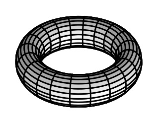
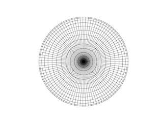
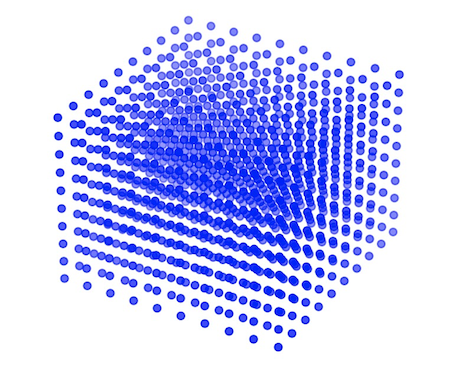

<h1 align="center">numgrids</h1>
<p align="center"> Working with numerical grids made easy. </p>

<p align="center"><a href="https://badge.fury.io/py/numgrids"> </a> <a href="https://github.com/maroba/numgrids/actions/workflows/checks.yml"> </a><a href="https://codecov.io/gh/maroba/numgrids"> </a> <a href="https://maroba.github.io/numgrids/"></a></p>

  <div align="center">   </div>

Setting up numerical grids, differentiation matrices, and coordinate
transformations by hand is tedious and error-prone.
*numgrids* gives you a high-level, NumPy-friendly API that handles all of
this — so you can focus on the physics or mathematics of your problem instead
of bookkeeping grid indices and scale factors.

**Main Features**

- Numerical grids in any dimension from **equidistant**, **Chebyshev**, **logarithmic**, and **periodic** axes
- High-precision **spectral methods** (FFT + Chebyshev) selected automatically where possible
- Differentiation, integration (Clenshaw–Curtis, trapezoidal), and interpolation (spline or spectral)
- **Curvilinear coordinates**: spherical, cylindrical, polar, elliptic cylindrical, prolate and oblate spheroidal — or your own via scale factors
- **Full disks, cylinders and balls**: a radial axis through the origin handles the center without a coordinate singularity
- **Vector calculus**: gradient, divergence, curl, and Laplacian on Cartesian and curvilinear grids; volume and surface integrals
- **Operator algebra** — write `-0.5 * D2 + V` — with built-in `solve()` for boundary value problems and `eig()` for eigenvalue problems
- **Boundary conditions**: Dirichlet, Neumann, and Robin, specified as compactly as `bcs={"x_low": 0, "x_high": Neumann(1)}`
- **Time evolution** (method of lines) for heat, wave, and Schrödinger-type equations
- **Adaptive mesh refinement**, convergence studies, multigrid hierarchies
- **Plotting**, **save / load** to `.npz`, and **xarray / NetCDF** interoperability
- Fully compatible with *NumPy* and *SciPy* (all operators export sparse matrices)

## Installation

```shell
pip install --upgrade numgrids
```

Optional extras: `numgrids[plot]` (matplotlib), `numgrids[xarray]` (xarray), or `numgrids[all]`.

## Documentation

Full documentation including user guide, API reference and example notebooks is available at
**[maroba.github.io/numgrids](https://maroba.github.io/numgrids/)**.

## Quick Start

### Grids, derivatives, integrals

```python
from numgrids import *
import numpy as np

# A 2D grid: Chebyshev points in x, periodic in y. Keyword arguments name the axes.
grid = Grid(x=chebyshev(30, 0, 1), y=periodic(40, 0, 2 * np.pi))

f = grid.evaluate(lambda x, y: x**2 * np.sin(y))   # sample a function

df_dx = grid.diff(f, axis="x")          # partial derivatives (spectrally accurate)
d2f_dy2 = grid.diff(f, order=2, axis="y")
lap = grid.laplacian(f)
total = grid.integrate(f**2)            # integral over the whole domain
value = grid.interpolate(f, (0.3, 1.2), method="spectral")
```

Axis types: `chebyshev(n, low, high)`, `equidistant(...)`, `periodic(...)`, `logarithmic(...)`.
The differentiation method (FFT, Chebyshev, finite differences) is chosen automatically
according to the axis type.

### Solving PDEs

Combine operators like formulas, then solve:

```python
# Poisson equation  ∇²u = -2π² sin(πx) sin(πy)  with u = 0 on the boundary
grid = Grid(x=chebyshev(30, 0, 1), y=chebyshev(30, 0, 1))
L = grid.laplacian_operator()
u = L.solve(lambda x, y: -2 * np.pi**2 * np.sin(np.pi * x) * np.sin(np.pi * y), bcs=0)

# Mixed boundary conditions per face
u = L.solve(1.0, bcs={"x_low": 0, "x_high": Neumann(0), "y_low": 0, "y_high": Robin(1, 1, 0)})
```

Eigenvalue problems — here the quantum harmonic oscillator — come without spurious modes:

```python
grid = Grid(x=chebyshev(80, -10, 10))
x = grid.coords
H = -0.5 * grid.diff_operator(2) + 0.5 * x**2

energies, states = H.eig(k=4, bcs=0)     # [0.5, 1.5, 2.5, 3.5]
```

Time-dependent problems are integrated with the method of lines:

```python
grid = Grid(x=chebyshev(40, 0, 1))
result = evolve(grid, 0.1 * grid.laplacian_operator(),     # heat equation u_t = 0.1 u_xx
                np.sin(np.pi * grid.coords), t_span=(0, 1), bcs=0, method="BDF")
grid.plot(result.final)
```

### Curvilinear grids & vector calculus

```python
grid = SphericalGrid(
    chebyshev(25, 0.1, 5),          # r
    chebyshev(20, 0.1, np.pi - 0.1),  # theta
    periodic(30),                   # phi
)
R, Theta, Phi = grid.meshed_coords
f = R**2

grid.laplacian(f)                   # = 6
gr, gt, gp = grid.gradient(f)       # (2r, 0, 0)
grid.divergence(gr, gt, gp)         # div(grad f) = laplacian f
grid.curl(gr, gt, gp)               # curl(grad f) = 0
grid.integrate(np.ones(grid.shape)) # volume of the shell (volume element included)
grid.faces["r_high"].integrate(f)   # surface integral over the outer sphere
```

`PolarGrid`, `CylindricalGrid`, `EllipticCylindricalGrid`, `ProlateSpheroidalGrid` and
`OblateSpheroidalGrid` work the same way. Any other orthogonal coordinate system can be
defined by its scale factors:

```python
grid = CurvilinearGrid(
    axis_q1, axis_q2, axis_q3,
    scale_factors=(
        lambda c: np.ones_like(c[0]),          # h_1(q)
        lambda c: c[0],                         # h_2(q) = q_1
        lambda c: c[0] * np.sin(c[1]),          # h_3(q) = q_1 sin(q_2)
    ),
)
```

## Example Notebooks

- [Operators and solvers: Poisson, eigenmodes, time evolution](examples/operators-and-solvers.ipynb)
- [Heat equation in a rod](examples/heat-equation-rod.ipynb)
- [Poisson equation in 2D](examples/poisson-equation-2d.ipynb)
- [Quantum harmonic oscillator](examples/quantum-harmonic-oscillator.ipynb)
- [Vibrations of a drum](examples/wave-equation-drum.ipynb)
- [Spherical harmonics](examples/spherical-harmonics.ipynb)
- [Convergence study](examples/convergence-study.ipynb)
- [Adaptive mesh refinement](examples/adaptive-refinement-demo.ipynb)

## How to Cite

If you use *numgrids* in a publication, please cite it as:

> M. Baer. *numgrids* software package. URL: https://github.com/maroba/numgrids. 2023

BibTeX entry:

```bibtex
@misc{numgrids,
  title  = {{numgrids} Software Package},
  author = {M. Baer},
  url    = {https://github.com/maroba/numgrids},
  key    = {numgrids},
  note   = {\url{https://github.com/maroba/numgrids}},
  year   = {2023}
}
```

## Development

Clone the repository and install it in development mode with all extras:

```shell
git clone https://github.com/maroba/numgrids.git
cd numgrids
pip install -e ".[dev]"
```

Run the tests (including the doctests in the docstrings) and the linter:

```shell
python -m pytest
ruff check numgrids tests
```

Build the documentation:

```shell
sphinx-build -b html docs docs/_build/html
```

### Contributing

1. Fork the repository
2. Develop
3. Write tests!
4. Create an [issue](https://github.com/maroba/numgrids/issues)
5. Create a pull request, when done
