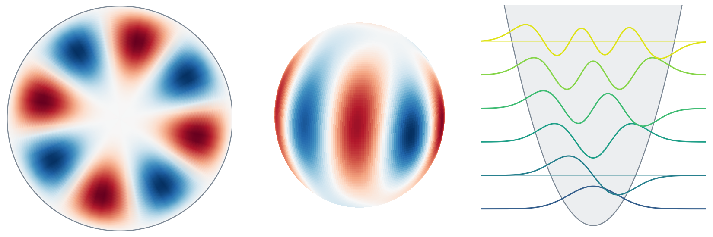
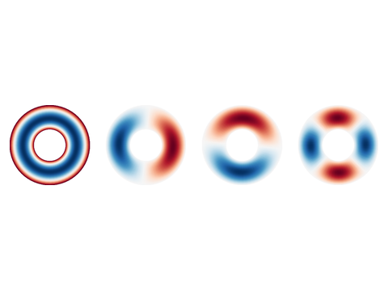
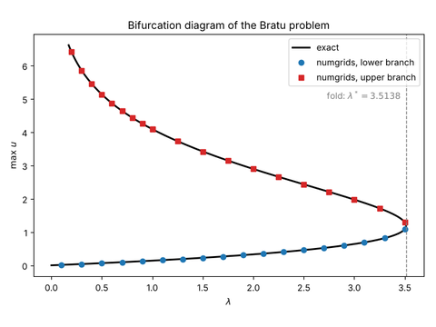
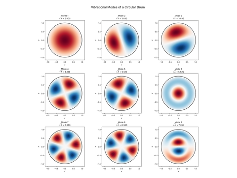
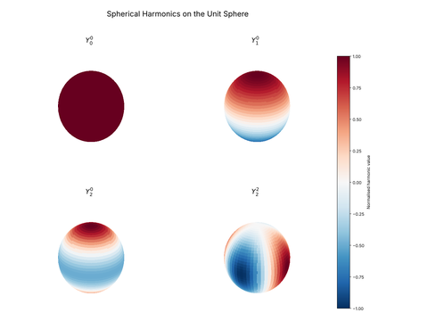
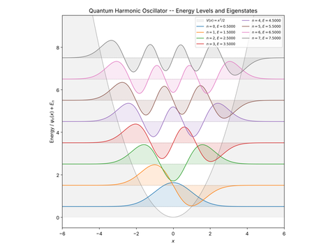
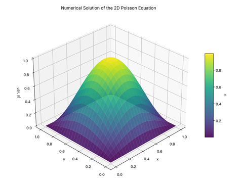
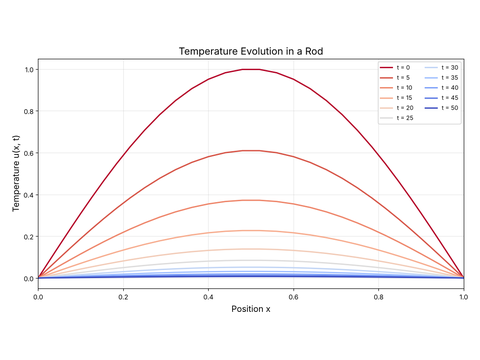
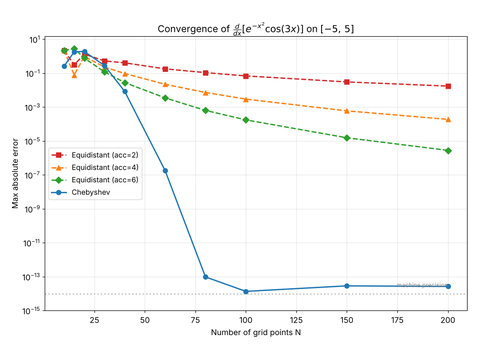
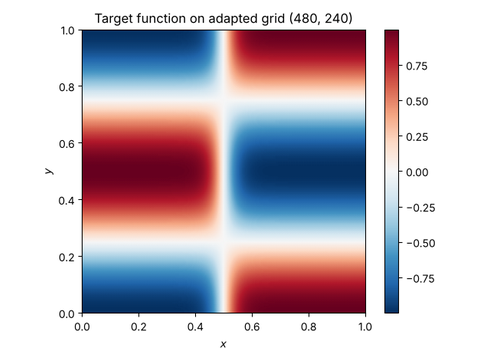

<h1 align="center">numgrids</h1>

<p align="center">
  <b>Numerical grids, spectral derivatives and PDE solvers in a few lines of NumPy-friendly Python.</b>
</p>

<p align="center">
  <a href="https://pypi.org/project/numgrids/"></a>
  <a href="https://pypi.org/project/numgrids/"></a>
  <a href="https://github.com/maroba/numgrids/actions/workflows/checks.yml"></a>
  <a href="https://codecov.io/gh/maroba/numgrids"></a>
  <a href="https://maroba.github.io/numgrids/"></a>
  <a href="LICENSE"></a>
</p>

<p align="center">
  
  <br>
  <sub>Computed with numgrids: a vibration mode of a circular drum, an eigenfunction of the Laplacian on the sphere,
  and the eigenstates of the quantum harmonic oscillator
  (<a href="docs/assets/scripts/make_hero.py">code</a>).</sub>
</p>

Setting up grids, differentiation matrices, boundary conditions and coordinate
transformations by hand is tedious and error-prone. *numgrids* handles all of
this, so you can focus on the physics or mathematics of your problem.

## numgrids in 30 seconds

What are the vibration frequencies of a circular drum? They are the square roots of the
eigenvalues of the Laplacian on a disk, with the rim clamped:

```python
from numgrids import *

drum = PolarGrid(radial(30, 1.0), periodic(40))     # the full disk, including its center
eigenvalues, modes = (-drum.laplacian_operator()).eig(k=6, bcs=0)

print(eigenvalues ** 0.5)
# [2.40482556 3.83170597 3.83170597 5.1356223  5.1356223  5.52007811]
```

These are the zeros of the Bessel functions, correct to 13 digits on a 30 × 40 grid. There's
no mesh generation, no hand-assembled matrices and no special treatment of the center.

## Features

**Grids and coordinates**
- Grids in any dimension from Chebyshev, equidistant, periodic and logarithmic axes
- Unbounded domains: the half line and the whole real line, without cutting the domain off
- Polar, cylindrical, spherical (volume and surface), elliptic and spheroidal coordinates, or your own via scale factors
- Full disks, cylinders, spheres and balls: the center and the poles are handled without coordinate singularities

**Calculus**
- Derivatives with spectral accuracy (FFT, Chebyshev) or finite differences, chosen automatically per axis
- Gradient, divergence, curl and Laplacian; volume and surface integrals; inner products and norms; spectral interpolation

**Solving equations**
- Write operators like formulas (`-0.5 * D2 + V`), then `solve()` boundary value problems or `eig()` eigenvalue problems (also generalized: `L u = λ M u`)
- Fast direct solvers, chosen automatically: problems on disks, spheres and balls decouple into small problems per Fourier mode; `factorize()` reuses a factorization for many right-hand sides
- Nonlinear boundary value problems with Newton's method: `solve_nonlinear()` only needs the residual, and `continuation()` follows solution branches around folds
- Dirichlet, Neumann and Robin conditions in one line: `bcs={"x_low": 0, "x_high": Neumann(1)}`
- Time evolution (method of lines) for heat, wave, reaction-diffusion and Schrödinger-type equations, with time-dependent boundary values and sources, and an exponential integrator without time stepping error

**Tools**
- Adaptive mesh refinement, convergence studies, a multigrid solver for large finite-difference problems
- Plotting, save/load, xarray/NetCDF; all operators export SciPy sparse matrices

## Installation

```shell
pip install numgrids
```

Optional extras: `numgrids[plot]` (matplotlib), `numgrids[xarray]` (xarray), or `numgrids[all]`.

## Examples

### Derivatives and integrals

```python
import numpy as np
from numgrids import *

grid = Grid(x=chebyshev(30, 0, 1), y=periodic(40))       # named axes
f = grid.evaluate(lambda x, y: x**2 * np.sin(y))

grid.diff(f, axis="x")             # spectrally accurate partial derivative
grid.laplacian(f)                  # d²f/dx² + d²f/dy²
grid.integrate(f**2)               # integral over the whole domain
grid.interpolate(f, (0.3, 1.2), method="spectral")
```

### Boundary value problems and time evolution

```python
# Poisson equation ∇²u = f on the unit square with u = 0 on the boundary
grid = Grid(x=chebyshev(30, 0, 1), y=chebyshev(30, 0, 1))
u = grid.laplacian_operator().solve(lambda x, y: np.sin(np.pi * x) * y, bcs=0)

# Heat equation u_t = 0.1 u_xx on a rod with fixed ends
rod = Grid(x=chebyshev(40, 0, 1))
result = evolve(rod, 0.1 * rod.laplacian_operator(), np.sin(np.pi * rod.coords),
                t_span=(0, 1), bcs=0, method="BDF")
rod.plot(result.final)
```

### A full ball

```python
ball = SphericalGrid(radial(16, 1.0), colatitude(16), periodic(32))
X, Y, Z = ball.cartesian_coords

ball.integrate(np.ones(ball.shape))      # 4.18879... = 4π/3, the volume element is built in
ball.laplacian(X**2 + Y**2 + Z**2)       # 6 everywhere, including the center and the poles
ball.faces["r_high"].integrate(Z**2)     # surface integral over the sphere: 4π/3
```

### Unbounded domains

```python
atom = Grid(r=semi_infinite(48, scale=10))          # the half line [0, ∞): no cutoff radius
r = atom.coords
V = np.append(0, -1 / r[1:])                        # Coulomb potential (the node r = 0 is a boundary point)
H = -0.5 * atom.diff_operator(2) + V

energies, states = H.eig(k=3, bcs=0, which="SR")
# [-0.5, -0.125, -0.05555556]: the levels -1/(2n²) of the hydrogen atom, correct to 12 digits
```

### Quantum dynamics

```python
grid = Grid(x=periodic(512, -60, 60))
x = grid.coords
H = -0.5 * grid.diff_operator(2) + 2.5 * np.exp(-x**2)          # a potential barrier
psi0 = np.exp(-(x + 20)**2 / 9 + 2j * x)                        # a wave packet moving towards it

result = evolve(grid, -1j * H, psi0, t_span=(0, 24), method="expm")   # exact in time, conserves the norm
grid.norm(result.final) / grid.norm(psi0)                             # 1.0
```

The [documentation](https://maroba.github.io/numgrids/) has a user guide for every feature and the full API reference.

## Example notebooks

<table>
  <tr>
    <td align="center" width="33%"><a href="https://maroba.github.io/numgrids/examples/operators-and-solvers.html"><br><b>Operators and solvers</b></a><br><sub>Poisson, eigenmodes, time evolution</sub></td>
    <td align="center" width="33%"><a href="https://maroba.github.io/numgrids/examples/nonlinear-problems.html"><br><b>Nonlinear problems</b></a><br><sub>Newton's method, continuation</sub></td>
    <td align="center" width="33%"><a href="https://maroba.github.io/numgrids/examples/wave-equation-drum.html"><br><b>Vibrations of a drum</b></a><br><sub>Eigenmodes of the full disk</sub></td>
  </tr>
  <tr>
    <td align="center" width="33%"><a href="https://maroba.github.io/numgrids/examples/spherical-harmonics.html"><br><b>Spherical harmonics</b></a><br><sub>Laplacian on the full sphere</sub></td>
    <td align="center" width="33%"><a href="https://maroba.github.io/numgrids/examples/quantum-harmonic-oscillator.html"><br><b>Quantum oscillator</b></a><br><sub>Schrödinger eigenvalue problem</sub></td>
    <td align="center" width="33%"><a href="https://maroba.github.io/numgrids/examples/poisson-equation-2d.html"><br><b>Poisson equation</b></a><br><sub>Boundary value problem in 2D</sub></td>
  </tr>
  <tr>
    <td align="center" width="33%"><a href="https://maroba.github.io/numgrids/examples/heat-equation-rod.html"><br><b>Heat equation</b></a><br><sub>Insulated, cooled and fixed ends</sub></td>
    <td align="center" width="33%"><a href="https://maroba.github.io/numgrids/examples/convergence-study.html"><br><b>Convergence study</b></a><br><sub>Spectral vs. finite differences</sub></td>
    <td align="center" width="33%"><a href="https://maroba.github.io/numgrids/examples/adaptive-refinement-demo.html"><br><b>Adaptive refinement</b></a><br><sub>Resolution where it is needed</sub></td>
  </tr>
</table>

## Citing numgrids

If you use *numgrids* in a publication, please cite it. The *Cite this repository* button in
the sidebar of the GitHub page provides APA and BibTeX entries, for example:

```bibtex
@software{numgrids,
  author = {Baer, Matthias},
  title  = {{numgrids}: Working with numerical grids made easy},
  url    = {https://github.com/maroba/numgrids},
  year   = {2023}
}
```

## Contributing

Contributions are welcome! See [CONTRIBUTING.md](CONTRIBUTING.md) for how to report bugs,
propose features and set up a development environment.

## License

*numgrids* is released under the [MIT License](LICENSE).
