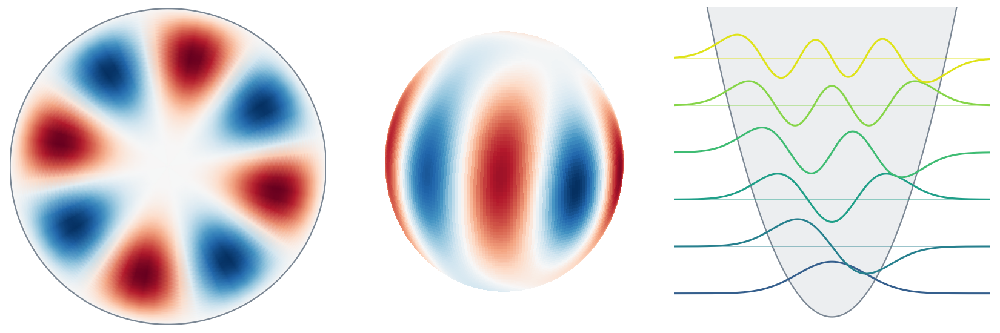

<h1 align="center">numgrids</h1>

<p align="center"><b>Numerical grids, spectral derivatives and PDE solvers in a few lines of NumPy-friendly Python.</b></p>

<p align="center">
  
</p>

Setting up grids, differentiation matrices, boundary conditions and coordinate
transformations by hand is tedious and error-prone. *numgrids* handles all of
this, so you can focus on the physics or mathematics of your problem.

## numgrids in 30 seconds

What are the vibration frequencies of a circular drum? They are the square roots of the
eigenvalues of the Laplacian on a disk, with the rim clamped:

```python
from numgrids import *

drum = PolarGrid(radial(30, 1.0), periodic(40))     # the full disk, including its center
eigenvalues, modes = (-drum.laplacian_operator()).eig(k=6, bcs=0)

print(eigenvalues ** 0.5)
# [2.40482556 3.83170597 3.83170597 5.1356223  5.1356223  5.52007811]
```

These are the zeros of the Bessel functions, correct to 13 digits on a 30 × 40 grid.

## Features

- **Grids and coordinates**: Chebyshev, equidistant, periodic and logarithmic axes in any dimension;
  unbounded domains (half line, whole line); polar, cylindrical, spherical (volume and surface), elliptic
  and spheroidal coordinates, or your own; full disks, cylinders, spheres and balls without coordinate
  singularities
- **Calculus**: spectral (FFT, Chebyshev) or finite-difference derivatives; gradient, divergence, curl,
  Laplacian; volume and surface integrals; inner products and norms; spectral interpolation
- **Solving equations**: operator algebra, `solve()` for boundary value problems with fast direct solvers
  chosen automatically, `eig()` for (generalized) eigenvalue problems, `solve_nonlinear()` and
  `continuation()` for nonlinear problems, Dirichlet/Neumann/Robin conditions in one line
- **Time evolution**: method of lines for heat, wave, reaction-diffusion and Schrödinger-type equations,
  time-dependent boundary values and sources, exponential integrator without time stepping error
- **Tools**: adaptive mesh refinement, convergence studies, plotting, save/load, xarray/NetCDF;
  all operators export SciPy sparse matrices

## Installation

```shell
pip install numgrids
```

Optional extras: `numgrids[plot]` (matplotlib), `numgrids[xarray]` (xarray), or `numgrids[all]`.

## Learn more

- Documentation, user guide and API reference: **[maroba.github.io/numgrids](https://maroba.github.io/numgrids/)**
- Example notebooks: [maroba.github.io/numgrids/examples](https://maroba.github.io/numgrids/examples/operators-and-solvers.html)
- Source code and issues: [github.com/maroba/numgrids](https://github.com/maroba/numgrids)
